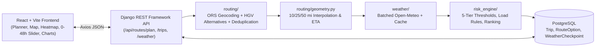

# Spotter RouteGuard — Weather-Aware Truck Routing Platform

A full-stack logistics intelligence application built with **React + Vite** and **Django REST Framework + PostgreSQL** that evaluates heavy-goods-vehicle (HGV) route alternatives using **ETA-synchronized weather forecasts**, **load-specific wind risk rules**, **interactive corridor heatmaps**, and a **0–48 hour forecast timeline**.

> **Decision-Support Notice:** Weather risk scores and route recommendations are decision-support estimates derived from third-party routing (OpenRouteService) and forecast (Open-Meteo) data. They do not guarantee road safety; dispatchers and drivers remain responsible for final safety decisions and official DOT/weather advisories.

---

## Key Features

- **HGV Multi-Route Generation (Up to 3 Options):** Uses OpenRouteService `driving-hgv` routing with automatic fallback to distinct lateral waypoint corridors and shortest-path comparisons for journeys exceeding public ORS native alternative limits (>100 km), plus strict geometry deduplication.
- **Configurable Checkpoint Engine (10 / 25 / 50 Miles):** Samples checkpoints along the decoded route polyline at 10, 25 (default), or 50-mile intervals, including origin and destination, using step-duration speed weighting when available to compute accurate checkpoint ETAs.
- **ETA-Based Batched Weather Integration:** Deduplicates close coordinates and fetches hourly imperial-unit forecasts (`°F`, `mph`, `in/hr`) from Open-Meteo in batched requests with Django cache support. Missing or out-of-horizon forecast periods are explicitly marked unavailable without fabricated data.
- **Exact Spotter 5-Tier Risk & Load Engine:** Evaluates every checkpoint against exact Wind, Rain, and Snow thresholds (`Low`, `Moderate`, `High`, `Severe`, `No Travel`) plus load-weight wind escalations (`>30,000 lb` and `>40,000 lb`).
- **Safety-First Route Recommendation:** Ranks routes in strict assessment priority order:
  1. Fewest **No Travel** miles
  2. Fewest **Severe** miles
  3. Fewest **High** miles
  4. Lowest average risk score
  5. Shortest travel time  
  *(If every candidate route crosses `No Travel` conditions, no route is marked safely recommended and a clear No Travel Advisory is shown.)*
- **Interactive Leaflet Map, Corridor Heatmap & 0–48h Forecast Slider:** View all routes, color-coded checkpoint markers, rich checkpoint popups/inspector, a real-data `leaflet.heat` corridor weather heatmap, and a playable 0–48h forecast timeline slider.
- **Recharts Weather Analytics & Operations Dashboard:** Wind threshold charts, precipitation/probability profiles, temperature vs. risk score charts, and real PostgreSQL-backed Dashboard & Saved Trips history.

---

## Technology Stack

- **Backend:** Python 3.13, Django 5.1, Django REST Framework, PostgreSQL (`psycopg[binary]`, `dj-database-url`), `django-cors-headers`, `httpx`, `python-dotenv`
- **Frontend:** React 18, Vite, React Router, Axios, Bootstrap 5 + Custom Light SaaS CSS Design System, Leaflet & React Leaflet, `leaflet.heat`, Recharts, Lucide React
- **External APIs:**
  - OpenRouteService / HeiGIT API (`https://api.heigit.org/pelias/v1/search`, `https://api.heigit.org/openrouteservice/v2/directions/driving-hgv/geojson`)
  - Open-Meteo Forecast API (`/v1/forecast`)
  - OpenStreetMap raster map tiles (`https://tile.openstreetmap.org/{z}/{x}/{y}.png`)

---

## Architecture Overview



---

## Folder Structure

```text
Spotter Labs/
├── backend/
│   ├── config/
│   │   ├── exceptions.py       # Centralized error envelopes & custom exceptions
│   │   ├── settings.py         # PostgreSQL & env-driven production/dev config
│   │   ├── test_settings.py    # Isolated in-memory settings for offline test runs
│   │   └── urls.py
│   ├── routing/
│   │   ├── geometry.py         # Haversine math, 10/25/50mi interpolation, ETAs, deduplication
│   │   ├── services.py         # OpenRouteService v2 geocoding & driving-hgv client
│   │   └── tests.py
│   ├── weather/
│   │   ├── codes.py            # WMO weather code descriptions
│   │   ├── services.py         # Batched Open-Meteo client, caching, 0-48h window
│   │   └── tests.py
│   ├── risk_engine/
│   │   ├── constants.py        # Configurable thresholds & load-weight rules
│   │   ├── services.py         # Checkpoint scoring, route aggregation, ranking
│   │   └── tests.py
│   ├── trips/
│   │   ├── migrations/
│   │   ├── models.py           # Trip, RouteOption, WeatherCheckpoint
│   │   ├── serializers.py      # Validation & nested response serializers
│   │   ├── services.py         # End-to-end TripPlanningService orchestration
│   │   ├── views.py            # Thin DRF views
│   │   ├── urls.py
│   │   └── tests.py
│   ├── .env.example
│   ├── manage.py
│   └── requirements.txt
├── frontend/
│   ├── src/
│   │   ├── components/         # PlannerForm, RouteComparisonCards, RouteMap, ForecastSlider, CheckpointPanel, WeatherCharts, RiskBadge
│   │   ├── hooks/              # useBackendHealth, useRouteWorkspace
│   │   ├── layouts/            # AppShell
│   │   ├── pages/              # DashboardPage, RoutePlannerPage, SavedTripsPage
│   │   ├── services/           # Axios api.js & error normalizer
│   │   ├── styles/             # tokens.css & app.css
│   │   ├── utils/              # formatters.js, riskStyles.js, leafletSetup.js
│   │   └── __tests__/          # Vitest + React Testing Library tests
│   ├── .env.example
│   ├── package.json
│   └── vite.config.js
├── .gitignore
└── README.md
```

---

## External API Setup & Environment Variables

### 1. OpenRouteService (`ORS_API_KEY`)
1. Create a free developer account at [account.heigit.org](https://account.heigit.org).
2. Generate a standard API token from your HeiGIT dashboard.
3. Add the token to `backend/.env` under `ORS_API_KEY`.  
   *(Never place `ORS_API_KEY` in `frontend/.env` or commit `.env` files to Git.)*

### 2. Open-Meteo (`OPEN_METEO_BASE_URL`)
- Uses the free forecast endpoint `https://api.open-meteo.com/v1` (no API key required for non-commercial forecast usage).

### 3. Backend Environment Variables (`backend/.env`)
Copy `backend/.env.example` to `backend/.env`:
```env
DEBUG=True
SECRET_KEY=replace-with-a-strong-random-django-secret-key
ALLOWED_HOSTS=localhost,127.0.0.1
DATABASE_URL=postgres://postgres:<YOUR_PASSWORD>@localhost:5432/spotter_routing
ORS_API_KEY=<YOUR_OPENROUTESERVICE_TOKEN>
ORS_BASE_URL=https://api.heigit.org/openrouteservice
ORS_GEOCODE_BASE_URL=https://api.heigit.org/pelias/v1
OPEN_METEO_BASE_URL=https://api.open-meteo.com/v1
CORS_ALLOWED_ORIGINS=http://localhost:5173,http://127.0.0.1:5173
EXTERNAL_API_TIMEOUT_SECONDS=15
WEATHER_CACHE_TTL_SECONDS=900
```

### 4. Frontend Environment Variables (`frontend/.env`)
Optional for local development (Vite proxies `/api` to `http://127.0.0.1:8000` by default):
```env
VITE_API_BASE_URL=http://127.0.0.1:8000/api
```

---

## Local Setup & Running on Windows

### Step 1: PostgreSQL Setup
Ensure PostgreSQL 16 is running, then create the database (using `psql.exe` or pgAdmin 4):
```powershell
& "C:\Program Files\PostgreSQL\16\bin\psql.exe" -U postgres -h localhost -c "CREATE DATABASE spotter_routing;"
```

### Step 2: Backend Installation & Run
```powershell
cd backend
python -m venv .venv
.\.venv\Scripts\Activate.ps1
pip install -r requirements.txt
Copy-Item .env.example .env   # Then edit .env with DATABASE_URL, SECRET_KEY, and ORS_API_KEY
python manage.py migrate
python manage.py runserver 8000
```

### Step 3: Frontend Installation & Run
In a second terminal:
```powershell
cd frontend
npm install
npm run dev
```
Open `http://localhost:5173` in your browser.

---

## API Endpoint Documentation

| Method | Endpoint | Purpose |
| :--- | :--- | :--- |
| `GET` | `/api/health/` | Returns API status, PostgreSQL connection status, and ORS/Open-Meteo readiness (never exposes secrets). |
| `POST` | `/api/routes/plan/` | Validates inputs (`origin`, `destination`, `departure_time`, `load_weight_lbs`, `checkpoint_interval_miles`), resolves up to 3 HGV routes, enriches ETA + 0–48h weather, scores risk, ranks routes, and persists to PostgreSQL. |
| `GET` | `/api/trips/` | Returns database-derived aggregate dashboard metrics (`stats`) and recent planned trips (`trips`). |
| `GET` | `/api/routes/<trip_id>/` | Returns full trip metadata, ranked route options, and checkpoint arrays. |
| `DELETE` | `/api/routes/<trip_id>/` | Deletes a saved trip and its cascaded routes/checkpoints. |
| `GET` | `/api/routes/<trip_id>/checkpoints/` | Returns checkpoints for a trip (supports `?route_id=<uuid>`). |
| `GET` | `/api/routes/<trip_id>/weather/` | Returns 0–48 hour hourly forecast arrays per checkpoint for the forecast slider and corridor heatmap. |

---

## Risk Scoring, Checkpoints & ETA Methodology

### Exact Classification Thresholds
| Condition | Low | Moderate | High | Severe | No Travel |
| :--- | :--- | :--- | :--- | :--- | :--- |
| **Wind (mph)** | `< 25` | `25 – <35` | `35 – <45` | `45 – <55` | `>= 55` |
| **Rain (in/hr)** | `< 0.10` | `0.10 – 0.25` | `> 0.25 – 0.50` | `> 0.50 – 1.00` | `> 1.00` |
| **Snow (in/hr)** | `< 0.5` | `0.5 – 1.0` | `> 1.0 – 2.0` | `> 2.0 – 3.0` | `> 3.0` |

### Load-Specific Wind Rules
- Wind `>= 55 mph` → **No Travel** for any load.
- Wind `45–54 mph` + Load `> 30,000 lb` → **No Travel**.
- Wind `35–44 mph` + Load `> 40,000 lb` → **Severe**.

### Numeric Risk Score & Route Exposure
Each checkpoint receives the worst tier across wind, rain, snow, and load rules plus a deterministic 0–100 sub-score aligned with tier bands (`Low: 0–24`, `Moderate: 25–49`, `High: 50–74`, `Severe: 75–89`, `No Travel: 90–100`) and small bounded compound penalties for simultaneous hazards or freezing precipitation. Route mileages (`low_miles`, `moderate_miles`, `high_miles`, `severe_miles`, `no_travel_miles`) are computed via Voronoi midpoint intervals along the route so segment miles sum exactly to total route distance.

### Checkpoint Interpolation & ETAs
Route coordinates from ORS GeoJSON are accumulated using haversine distances, scaled to ORS summary distance, and sampled at `0`, `N`, `2N`, ... miles (`N ∈ {10, 25, 50}`) plus the destination endpoint. When ORS segment step durations (`way_points` + `duration`) are available, vertex ETAs reflect road speed variations; otherwise ETAs scale proportionally across route duration.

---

## Testing

### Backend Automated Tests
```powershell
# With PostgreSQL configured in backend/.env:
backend\.venv\Scripts\python.exe backend\manage.py test routing weather risk_engine trips

# Offline / CI isolated test settings (mocked ORS & Open-Meteo):
backend\.venv\Scripts\python.exe backend\manage.py test routing weather risk_engine trips --settings=config.test_settings -v 2
```

### Frontend Automated Tests & Production Build
```powershell
cd frontend
npm test
npm run build
```

---

## Known Limitations

- **OpenRouteService 100 km Alternative Limit:** Public ORS servers reject `alternative_routes` requests when route distance exceeds ~100 km (`62 miles`). For long-haul routes, the backend uses `preference: "recommended"`, `preference: "shortest"`, and lateral perpendicular midpoint bypass corridors (snapped to truck roads within 60 km) and deduplicates near-identical paths. If fewer than 3 genuinely distinct routes exist, only distinct options are returned and a note is surfaced in the UI.
- **Open-Meteo Forecast Horizon:** Standard forecast coverage extends up to 16 days ahead; checkpoints or 0–48h slider slices outside coverage are explicitly flagged `Forecast Unavailable`.
- **Route Geometry & Live Traffic:** Weather risk is evaluated at forecast hourly resolution along HGV corridors without real-time incident/construction feeds.

---

## Deployment Checklist

1. Set `DEBUG=False`, a unique `SECRET_KEY`, production `ALLOWED_HOSTS`, `CORS_ALLOWED_ORIGINS`, and managed PostgreSQL `DATABASE_URL` in backend environment settings.
2. Run `python manage.py migrate` and `python manage.py collectstatic --noinput` (serve Django via Gunicorn/Waitress/Uvicorn behind HTTPS).
3. Set `VITE_API_BASE_URL` to your deployed backend `/api` URL and build the frontend static bundle with `npm run build` (`frontend/dist/`).
